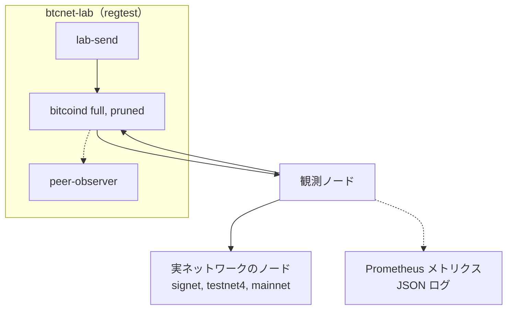

# 要件定義

2026-11-24 時点で合意した内容。実装はまだ始めていない。

## 目的

Bitcoin ノードのうち、P2P のネットワーク機能だけを持つ観測ノードを作る。
ブロックもトランザクションも検証せず、保存せず、中継しない。相手のノードに 1 ピアとしてつながり、相手が送ってくるものを記録する。

- **主目的 1**: btcnet-lab で peer-observer と併用し、外側からの視点を足す。
  送り手の試験メッセージが、第三者のピアにどう波及するかを見る。
  btcnet-lab は、regtest のノードに試験用の P2P メッセージを送り、反応を peer-observer で観測するラボ（非公開）。
- **主目的 2**: 実ネットワーク（signet、testnet4、mainnet）のノードを、フルノードなしで観測する。

最初に見るものは次の 2 つ。

- **中継と告知**: addr、inv、ブロックの告知が届くか、いつ届くか。
- **生のバイト列と v2**: メッセージの枠組みそのもの、12 文字の種別名、v2 トランスポートの decoy と garbage。

### 見えるもの、見えないもの

peer-observer の置き換えではない。peer-observer はノードの内側を、観測ノードは外側を見る。

| | peer-observer（ebpf, rpc, log） | 観測ノード |
|---|---|---|
| 見える範囲 | そのノードの全ピアとの送受信 | 自分との接続だけ |
| ノードの内側（Misbehaving の理由、切断の判断） | 見える | 見えない |
| 他のピア（送り手など）がそのノードに送ったもの | 見える | 見えない |
| 前提 | Linux、権限、USDT 付きの Bitcoin Core 29 以上 | なし。Mac でも、Core 以外の実装が相手でも動く |
| 生のバイト列 | 見えない（種別名は 11 文字で切れる） | 見える |

「送り手の試験メッセージにノードがどう反応したか」は、観測ノードだけではわからない。
観測ノードに見えるのは、その結果が別の接続に現れた分だけである。

## 全体の構成



実線は P2P の接続で、矢印は接続を張る向き。点線は観測データの流れ。
ラボでは bitcoind と両方向につながり、実ネットワークでは自分から張るだけにする。

## 決定事項

### 1. リポジトリとラボの関係

- 観測ノードはこのリポジトリで開発する。公開リポジトリで、ライセンスは MIT。
- btcnet-lab はこれをビルドして試す場所になる。このリポジトリを devenv の input として取り込み、ロックファイルで版を固定する。
  ラボ側の配線は btcnet-lab の文書に書く。
- このリポジトリの flake は `packages`（観測ノード）と `devenvModules`（サービス）を公開する。
- サービスは `services/<名前>/`、パッケージは `packages/<名前>/package.nix` に置く。接続先は `{ host; port; }` の形で明示して渡す。
- Rust は Cargo のワークスペースにして、P2P のライブラリ（トランスポート、ハンドシェイク、生のバイト列の記録）と観測ノード本体を分ける。
- btcnet-lab の送り手は当面そのままにする。P2P のライブラリが固まったら、送り手から git 依存で使う形に寄せられる。

取り込む側の `devenv.nix` の書き方の案。オプション名（`observer.services`）は仮。

```nix
{inputs, ...}: {
  imports = [inputs.observer.devenvModules.default];

  # 観測ノード 1 台が、渡した相手すべてにつながる
  observer.services.observer.lab = {
    enable = true;
    network = "regtest";
    peers = {
      full = { host = "127.0.0.1"; port = 18444; };
      pruned = { host = "127.0.0.1"; port = 18454; };
    };
  };
}
```

相手のノードから観測ノードへの接続は、相手の `addnode` に観測ノードの待ち受けアドレスを足して張らせる。

### 2. 接続

- **ラボ**: 両方向につなぐ。観測ノードから bitcoind に張る接続と、bitcoind が `addnode` で観測ノードに張る接続の両方を持つ。
  Core は接続の向きで振る舞いを変えるので、見比べられるようにする。
- **実ネットワーク**: 少数の相手に、自分から張る。待ち受けはしない。相手は設定で指定するか、DNS seed から選ぶ。
- addr をたどって多数のノードを巡回するクローラーにはしない。
- 接続ごとに、相手の名前、向き、ネットワーク、トランスポート（v1、v2）を記録に付ける。

### 3. 振る舞い

- ハンドシェイクでは、サービスフラグを何も立てず、トランザクションの告知を受け取る設定にする。
  `sendaddrv2`、`wtxidrelay`、`sendheaders` を送り、告知を受け取れる状態にする。
- 相手の ping には pong を返す。`getheaders` には空の `headers` を返す。
- ブロックもトランザクションも要求しない。告知を受けても取りに行かない。
- 受け取ったものを他の接続に流さない。自分からは何も告知しない。
- 仕様に反するメッセージは送らない。試験用のメッセージを送るのは btcnet-lab の送り手の役で、regtest に限る。

### 4. トランスポート

- v1 と v2（BIP324）の両方を、最初の段階から扱う。
- 自分から張るときは v2 を試し、相手が対応していなければ v1 で張り直す。設定でどちらかに固定できる。
- 受けるときは、相手の最初のバイト列で v1 か v2 かを見分ける。
- 枠組みの単位でバイト列を取り出せる作りにする。
  - v1: 24 バイトのヘッダー（magic、種別、長さ、チェックサム）とペイロード。
  - v2: ハンドシェイクの garbage の長さ、復号後のパケットの中身、decoy かどうか。

### 5. 定期的な問い合わせ

観測ノードは受け身ではなく、次の問い合わせを周期的に送って応答を記録する。種類ごとに間隔を設定でき、止められる。

| 種類 | 送るもの | 制約 |
|---|---|---|
| 応答時間 | `ping` | なし。往復時間を記録する |
| チェーンの先端 | `getheaders` | 直前に知った先端から先を聞く。ヘッダーは検証せず、先端を覚えるだけ |
| アドレス | `getaddr` | Core は受けた接続に 1 回しか応えないので、接続の張り直しと組にする。mainnet では同じ相手に 1 日 1 回まで |
| フィルター | `getcfcheckpt`、`getcfheaders` | `NODE_COMPACT_FILTERS` を名乗る相手にだけ送る |

bitcoind が自分から張った接続（観測ノードが受けた接続）では、Core は `getaddr` を無視する。アドレスの問い合わせは、観測ノードから張った接続でだけ行う。

### 6. 記録するもの

- **メッセージ**: 受信と送信の、種別ごとの件数とバイト数。種別名は 12 文字をそのまま使う。
- **中継と告知**: addr と addrv2、inv（トランザクション、ブロック）、headers の受信時刻と中身の要約。
  同じものが複数の接続に届いたときの時刻の差を出せるようにする。
- **接続**: 開始、終了、どちらが閉じたか。ハンドシェイクで相手が名乗った版、サービスフラグ、user agent、機能の交渉メッセージ。
- **問い合わせの応答**: 往復時間と件数。
- **v2**: garbage の長さ、decoy の数。

### 7. 出力

- **Prometheus メトリクス**: ネットワーク、相手の名前、向き、トランスポートのラベルを付ける。
- **JSON ログ**: 個々のイベントを 1 行 1 件で出す。
- **生のバイト列**: 既定では残さない。指定したときだけ、上限を決めて別のファイルに書く。
- peer-observer の NATS には流さない。`p2p_extractor` のイベントは 4 種類に限られ、相手と向きの区別が載らないため。

### 8. 実ネットワークでの作法

実ノードの接続枠を使うので、次を守る。

- 接続数に上限を置く。既定値は小さくする。
- user agent に、名前、版、連絡先の URL を入れる。
- サービスフラグは正直に名乗る（何も提供しない）。
- 何も中継せず、仕様に反するメッセージを送らない。
- 相手に切断されたら、間隔を空けてから張り直す。
- mainnet は、明示的に指定したときだけつなぐ。

### 9. 実装

- Rust で書く。非同期の実行基盤は tokio。長く動き、複数の接続を同時に持つため。
- P2P メッセージは `bitcoin` 0.32 の `bitcoin::p2p`、v2 トランスポートは `bip324` を使う。
- 段階は次の順にする。
  1. ラボで、v1 と v2、両方向の接続、受信の記録、メトリクスと JSON ログ。
  2. 定期的な問い合わせ。
  3. 実ネットワーク。signet と testnet4 で作法を確かめてから mainnet。

## 確かめた事実

設計の根拠にしたもの。2026-11-23 と 24 に各リポジトリのソースを読んで確かめた。

- **peer-observer の p2p-extractor**（rev `8889014`、`extractors/p2p/src/lib.rs`、`protobuf/p2p_extractor.proto`）
  - rust-bitcoin の `bitcoin::p2p` で書かれた、ネットワーク機能だけのノード。先行例にあたる。
  - 待ち受けだけで、自分からは張らない。v1 だけを受け、magic が合わない接続（v2 を含む）は切る。
  - 複数のノードからの接続を区別できない（README）。
  - イベントは ping の往復時間、addrv2、inv、feefilter の 4 種類。
- **Rust のクレート**（crates.io、rust-bitcoin の master）
  - `bitcoin` の安定版は 0.32 系で、`bitcoin::p2p` がある。btcnet-lab の送り手は 0.32.102 を使っている。
  - master では P2P メッセージが `bitcoin-p2p-messages` クレートに切り出され、`bitcoin` 本体に `p2p` モジュールはない。
    `bitcoin-p2p-messages` は crates.io に未公開。
  - `bip324` は 0.11.1。secp256k1 0.29 に依存し、`bitcoin` 0.32 と揃う。`bitcoin` には依存しない。
    同期の I/O と tokio の I/O があり、decoy のパケットを区別でき、相手が v1 のときのエラー（`V1Protocol`）がある。
- **Bitcoin Core v31.1**（`net_processing.cpp`、`net.cpp`、`net.h`）
  - `getaddr` を送るのは、自分から張った接続にだけ。
  - 受けた接続には、相手が addr 系のメッセージ（`addr`、`addrv2`、`getaddr`）を送るまで addr を中継しない。
  - `getaddr` に応えるのは受けた接続にだけで、1 接続につき 1 回。応答は約 24 時間キャッシュされる。
  - 手動の接続（`addnode`、`connect`）には、サービスフラグの確認もチェーン同期による切断もかからない。
  - 手動の接続は、自分が v2 に対応していれば v2 で張り、失敗すると v1 で張り直す。v2 は既定で有効。
  - フィルターを提供していないノードは、BIP157 の要求を受けると切断する。
- **btcnet-lab**
  - 外部のモジュールを `devenv.yaml` の input にして、`devenv.lock` で固定している。
  - VM は Mac のホームを同じパスで読み取り専用にマウントしている（`vm/lima.yaml`）。
  - サービスフラグなしの v1 の接続を、bitcoind 31.1 が受け付ける（送り手の 36 件が通っている）。

## 実装の最初に確かめること

未確認の点。設計が崩れる可能性があるものから順に並べている。

1. **サービスフラグなしの相手への告知**: Core が、何も提供しないと名乗るピアに inv と headers の告知を送るか。受けた接続と張った接続の両方で確かめる。
2. **空の headers での接続の維持**: `getheaders` に空の `headers` を返し続けて、切断されないか。ラボの `addnode` の接続と、実ネットワークで自分から張った接続の両方で確かめる。
3. **v2 のメッセージ種別**: BIP324 の短縮 ID と種別名の対応表を、どのクレートが持っているか。なければ自前で持つ。
4. **bip324 で取り出せる情報**: garbage の長さと decoy を、高水準の I/O から取れるか。取れなければ低水準の `Handshake` を使う。
5. **受けた接続での v1 と v2 の見分け**: `bip324` の受け側で v1 を検出したあと、読んだバイト列を捨てずに v1 として続けられるか。
6. **手元の変更をラボで試す方法**: push していないチェックアウトを、devenv の input に差し替える指定方法。
7. **DNS seed からの相手選び**: 実ネットワークで、少数の相手をどう選び、どう入れ替えるか。
8. **`bitcoin` 0.33 への移行**: `bitcoin-p2p-messages` が公開された時点で、依存をどう切り替えるか。
